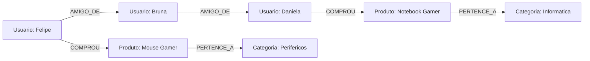

# Banco de Dados NoSQL - Grafos (Neo4j) e Cache Key-Value (Redis)

Trabalho da disciplina de Banco de Dados. O objetivo e modelar duas coisas:

1. um **grafo de recomendacao** para um e-commerce, capaz de responder "amigos de amigos que compraram o Produto X";
2. uma **estrutura de chaves de cache** para o carrinho de compras, com TTL para carrinho abandonado e invalidacao no checkout.

Todos os scripts estao em arquivos `.cypher` e `.redis`, prontos para rodar no `cypher-shell` e no `redis-cli`.

---

## Estrutura do repositorio

```
.
├── grafo/
│   ├── 01-modelagem-e-insercao.cypher            # Parte 1 - nos, arestas e constraints
│   ├── 02-recomendacao-amigos-de-amigos.cypher   # Parte 2 - consulta de recomendacao
│   └── 03-desafio-recomendacao-colaborativa.cypher # Parte 3 - desafio
├── cache/
│   ├── 01-key-design.redis                       # Parte 1 - padrao das chaves
│   ├── 02-operacoes-carrinho.redis               # Parte 2 - HSET / HGETALL / EXPIRE
│   └── 03-invalidacao-checkout.redis             # Parte 3 - invalidacao (bonus)
├── docker-compose.yml                            # sobe Neo4j e Redis
└── README.md
```

---

## Como executar

### Subindo os bancos

```bash
docker compose up -d
```

Neo4j Browser em http://localhost:7474 (usuario `neo4j`, senha `senha123`) e Redis na porta 6379.

### Scripts do grafo

```bash
cypher-shell -a bolt://localhost:7687 -u neo4j -p senha123 -f grafo/01-modelagem-e-insercao.cypher
cypher-shell -a bolt://localhost:7687 -u neo4j -p senha123 -f grafo/02-recomendacao-amigos-de-amigos.cypher
cypher-shell -a bolt://localhost:7687 -u neo4j -p senha123 -f grafo/03-desafio-recomendacao-colaborativa.cypher
```

Tambem funciona copiando e colando o conteudo no Neo4j Browser.

### Scripts do cache

O `redis-cli` nao interpreta linhas de comentario, entao o `grep` remove os comentarios antes de enviar os comandos:

```bash
grep -v '^#' cache/01-key-design.redis        | grep -v '^$' | redis-cli
grep -v '^#' cache/02-operacoes-carrinho.redis | grep -v '^$' | redis-cli
grep -v '^#' cache/03-invalidacao-checkout.redis | grep -v '^$' | redis-cli
```

Os arquivos devem ser executados nessa ordem, porque o 02 usa o carrinho criado no 01 e o 03 invalida o carrinho usado no 02.

---

## Parte 1 - Modelagem

### Modelo de grafo

**Tipos de no**

| No | Propriedades | Qtd. |
|---|---|---|
| `:Usuario` | `id`, `nome`, `email`, `cidade`, `data_cadastro` | 8 |
| `:Produto` | `id`, `nome`, `preco`, `estoque`, `marca` | 8 |
| `:Categoria` | `nome` | 6 |

**Tipos de aresta**

| Aresta | Direcao | Propriedades |
|---|---|---|
| `:AMIGO_DE` | `(:Usuario)-->(:Usuario)` | `desde` |
| `:COMPROU` | `(:Usuario)-->(:Produto)` | `data`, `quantidade`, `valor_pago` |
| `:PERTENCE_A` | `(:Produto)-->(:Categoria)` | - |

O enunciado pedia pelo menos dois tipos de no e dois de aresta; `:Categoria` e `:PERTENCE_A` entraram para permitir a recomendacao por categoria preferida no desafio.



**Sobre a direcao do `:AMIGO_DE`:** amizade e simetrica, mas toda aresta no Cypher e gravada com direcao. Por isso cada amizade e criada nos dois sentidos (`A->B` e `B->A`), o que deixa as consultas livres para usar a seta sem perder resultado. A alternativa seria gravar em um sentido so e consultar com `-[:AMIGO_DE]-` (sem seta), que o Neo4j trata como "qualquer direcao".

**Rede criada**

```
Felipe(1)  --- Bruna(2), Carlos(3)
Bruna(2)   --- Felipe(1), Daniela(4), Eduardo(5)
Carlos(3)  --- Felipe(1), Eduardo(5), Fernanda(6)
Daniela(4) --- Bruna(2), Gabriel(7)
Helena(8)  --- (sem amizades, serve de controle)
```

As compras foram montadas de proposito para testar os limites da consulta: **Carlos** comprou o Notebook mas e amigo direto, **Gabriel** comprou e esta a tres saltos, e **Helena** comprou mas nao tem nenhuma amizade. Nenhum dos tres pode aparecer no resultado.

### Estrutura de cache

Padrao de nomenclatura adotado:

```
<dominio>:<entidade>:<identificador>[:<sufixo>]
```

| Chave | Tipo | Conteudo | TTL |
|---|---|---|---|
| `cart:user:{userId}` | Hash | campo = `produto:{produtoId}`, valor = quantidade | 86400s (24h) |
| `cart:session:{sessionId}` | Hash | mesmo formato, para visitante sem login | 7200s (2h) |
| `cart:user:{userId}:meta` | Hash | `atualizado_em`, `cupom`, `canal` | 86400s |
| `cart:abandoned` | ZSet | indice de carrinhos ativos, score = timestamp | sem TTL |

Exemplos: `cart:user:1`, `cart:user:1:meta`, `cart:session:a1b2c3d4`.

Regras seguidas: `:` como separador (convencao da propria Redis, e o que o RedisInsight usa para desenhar a arvore de chaves), tudo em minusculo e sem acento, prefixo de dominio sempre primeiro (permite `SCAN MATCH cart:*`), identificador no fim do nivel e nome curto, porque a chave tambem ocupa memoria.

**Por que Hash e nao uma String com JSON:** alterar a quantidade de um item nao exige reescrever o carrinho inteiro. `HSET` e `HINCRBY` mexem em um campo so, em O(1), enquanto com JSON seria `GET` -> desserializar -> alterar -> serializar -> `SET`, um read-modify-write que ainda abre espaco para condicao de corrida entre duas abas do navegador. Fora isso, `HGETALL` traz o carrinho completo em uma unica ida ao servidor, `HLEN` conta os itens sem trazer os dados e um Hash pequeno e guardado internamente como listpack, ocupando menos memoria que o JSON equivalente.

**Por que nao uma chave por item** (`cart:user:1:produto:102`): ler o carrinho exigiria `SCAN` ou varias chamadas, e cada item teria TTL proprio - o carrinho expiraria em pedacos e o cliente veria um carrinho incompleto. Como o TTL no Redis e por chave e o carrinho inteiro precisa expirar junto, um Hash por carrinho e a granularidade certa.

Uma decisao importante: o cache guarda **somente `produto_id` e `quantidade`**. Preco, nome, estoque e total sao lidos do banco principal na hora de montar a tela e novamente no checkout. Assim nao existe preco desatualizado no cache para invalidar, que e o bug mais comum nesse tipo de estrutura.

---

## Parte 2 - Consultas e operacoes

### Grafo: amigos de amigos que compraram o Produto X

```cypher
MATCH (eu:Usuario {id: 1})-[:AMIGO_DE]->(amigo:Usuario)-[:AMIGO_DE]->(fof:Usuario)-[:COMPROU]->(produto:Produto {nome: 'Notebook Gamer'})
WHERE fof <> eu
  AND NOT (eu)-[:AMIGO_DE]->(fof)
RETURN DISTINCT fof.nome AS recomendado_por, produto.nome AS produto, produto.preco AS preco
ORDER BY recomendado_por;
```

Sao tres saltos no grafo: `(eu) -> (amigo) -> (amigo do amigo) -> (produto)`. Os dois filtros do `WHERE` eliminam os falsos positivos: `fof <> eu` evita que eu volte para mim mesmo pelo caminho de ida e volta, e `NOT (eu)-[:AMIGO_DE]->(fof)` tira quem ja e meu amigo direto, que nao e "amigo de amigo".

Resultado com os dados do script 01:

| recomendado_por | produto | preco |
|---|---|---|
| Daniela | Notebook Gamer | 7499.90 |
| Eduardo | Notebook Gamer | 7499.90 |

O arquivo `grafo/02-...` ainda traz a mesma consulta com salto de tamanho variavel (`[:AMIGO_DE*2]`), uma versao com prova social (Eduardo chega por dois caminhos, Bruna e Carlos, e por isso tem conexao mais forte que Daniela), a versao parametrizada que a aplicacao usaria de verdade e um `PROFILE` para olhar o custo da travessia.

### Cache: operacoes do carrinho

```bash
# adicionar item (e somar quantidade de forma atomica)
HSET cart:user:1 produto:104 1
HINCRBY cart:user:1 produto:104 1

# ler o carrinho completo
HGETALL cart:user:1

# TTL de 24h - simula o abandono do carrinho
EXPIRE cart:user:1 86400
TTL cart:user:1
```

Detalhe que importa: `DEL` ou um `HSET` em chave nova zeram o TTL. Toda escrita no carrinho precisa renovar a expiracao, senao o carrinho se torna uma chave eterna na memoria. Na aplicacao real isso vira um bloco atomico:

```bash
MULTI
HINCRBY cart:user:1 produto:105 1
HSET cart:user:1:meta atualizado_em 1764003600
EXPIRE cart:user:1 86400
ZADD cart:abandoned 1764003600 user:1
EXEC
```

O arquivo `cache/02-...` cobre ainda a remocao de item (`HDEL`), a leitura parcial (`HGET`, `HKEYS`, `HLEN`), o TTL menor para visitante nao logado, a migracao do carrinho de sessao para o carrinho do usuario no login e a listagem dos carrinhos abandonados com `ZRANGEBYSCORE` e `SCAN` (nunca `KEYS` em producao, porque bloqueia o servidor).

---

## Parte 3 - Desafio

### Grafo: quem comprou o mesmo que voce tambem comprou Y

```cypher
MATCH (eu:Usuario {id: 1})-[:COMPROU]->(comum:Produto)<-[:COMPROU]-(outro:Usuario)-[:COMPROU]->(sugestao:Produto)
WHERE outro <> eu
  AND NOT (eu)-[:COMPROU]->(sugestao)
RETURN sugestao.nome                  AS produto_sugerido,
       count(DISTINCT outro)          AS usuarios_que_confirmam,
       collect(DISTINCT comum.nome)   AS por_causa_de
ORDER BY usuarios_que_confirmam DESC;
```

A seta de volta `<-[:COMPROU]-` e o coracao da consulta: significa "esse produto tambem foi comprado por outra pessoa". Em SQL isso seria a tabela de compras cruzada consigo mesma duas vezes.

Resultado (Felipe comprou Mouse Gamer e Teclado Mecanico):

| produto_sugerido | usuarios_que_confirmam | por_causa_de |
|---|---|---|
| Notebook Gamer | 3 (Daniela, Eduardo, Helena) | Mouse Gamer RGB, Teclado Mecanico |
| Monitor 144Hz | 1 (Fernanda) | Teclado Mecanico |
| Cadeira Gamer | 1 (Eduardo) | Mouse Gamer RGB |
| SSD NVMe 1TB | 1 (Fernanda) | Teclado Mecanico |
| Headset 7.1 | 1 (Daniela) | Teclado Mecanico |

O mesmo arquivo traz tres variacoes: uma com **score ponderado**, onde cada vizinho pesa conforme quantos produtos tem em comum comigo (quem tem gosto mais parecido influencia mais); uma **hibrida**, que soma a distancia social medida com `shortestPath` ao gosto em comum; e uma por **categoria preferida**, usando os nos `:Categoria` para atender o usuario novo, que tem poucas compras e poucos vizinhos (o problema do cold start).

### Cache (bonus): estrategia de invalidacao

A ordem das operacoes no checkout e o ponto central:

1. ler o carrinho do Redis (`HGETALL cart:user:1`);
2. validar preco e estoque no banco principal, que e a fonte da verdade;
3. gravar o pedido no banco principal e **commitar**;
4. confirmar o pagamento;
5. **somente entao** invalidar o cache.

Se o cache fosse apagado antes de o pedido ser gravado e a gravacao falhasse, o cliente ficaria sem carrinho e sem pedido - o pior resultado possivel. Invalidando depois, o pior caso e um carrinho que sobrevive alguns segundos, e que o proprio TTL de 24h resolve.

```bash
# resposta direta do exercicio
DEL cart:user:1

# o que a aplicacao executa de verdade: carrinho, metadados e indice, em um passo atomico
MULTI
UNLINK cart:user:1
UNLINK cart:user:1:meta
ZREM cart:abandoned user:1
EXEC
```

`UNLINK` em vez de `DEL` porque ele retira a chave do espaco de nomes na hora e libera a memoria em uma thread de fundo, o que evita travar o servidor quando o carrinho tem muitos itens. A operacao tambem e **idempotente**: apagar chave inexistente retorna `0` sem erro, entao se a fila de pedidos entregar o mesmo evento de checkout duas vezes, a segunda execucao nao quebra nada.

Gatilhos de invalidacao:

| Evento | Acao |
|---|---|
| Checkout concluido | `DEL`/`UNLINK` do carrinho, dos metadados e do indice |
| Cliente clica em "limpar carrinho" | `DEL` do carrinho |
| Item removido da tela | `HDEL` do campo (invalidacao parcial) |
| Preco ou estoque mudou | nada a fazer: preco nao fica no cache |
| Logout | mantem o carrinho (volta no proximo login) |
| Carrinho abandonado | expira sozinho pelo TTL |

Conferencia esperada depois da invalidacao: `EXISTS cart:user:1` retorna `0`, `HGETALL` retorna vazio e `TTL` retorna `-2` (chave inexistente; `-1` seria chave existente sem expiracao).

---

## Parte 4 - Reflexao

### Por que um banco de grafos resolve "amigos de amigos" melhor que SQL com JOINs?

Em um banco relacional, as amizades ficam numa tabela `amizades(usuario_id, amigo_id)` e as compras em `compras(usuario_id, produto_id)`. Para responder "amigos de amigos que compraram o produto X" e preciso cruzar `amizades` consigo mesma duas vezes e ainda juntar `compras` e `produtos`. Mesmo com indice em cada coluna, o banco monta resultados intermediarios: o primeiro JOIN gera os amigos, o segundo multiplica aquilo pelos amigos de cada amigo, e so depois vem o filtro do produto. Se eu quiser um salto a mais, preciso **reescrever a consulta** com outro self-join (ou partir para um `WITH RECURSIVE`, que e mais dificil de ler e continua materializando os intermediarios). O custo cresce com o tamanho das tabelas, nao com o tamanho da minha vizinhanca: quanto mais usuarios o sistema tiver, mais caro fica responder a mesma pergunta.

O Neo4j usa **index-free adjacency**: cada no guarda ponteiros diretos para suas proprias arestas. Sair de um no para os vizinhos e seguir um ponteiro, nao procurar numa estrutura de indice. O indice e usado uma unica vez, para achar o ponto de partida (`{id: 1}`); dali em diante a consulta caminha apenas pelas arestas que existem de verdade. O custo fica proporcional ao numero de relacionamentos visitados e praticamente independente do tamanho total do banco - um milhao de usuarios que nao fazem parte da minha rede nao deixam a consulta mais lenta. Isso aparece no `PROFILE` que esta no final do script 02: os db hits ficam contidos na vizinhanca percorrida.

Tem tambem o lado da legibilidade, que na pratica pesa bastante. O padrao `(eu)-[:AMIGO_DE]->()-[:AMIGO_DE]->(fof)-[:COMPROU]->(produto)` **desenha** a pergunta, e aumentar a profundidade e trocar `*2` por `*1..3`, sem reescrever nada.

Para ser justo: em um unico nivel ("meus amigos que compraram X") o SQL resolve numa boa, com um JOIN simples, e para relatorio agregado sobre tudo (faturamento por mes, ticket medio) o relacional continua melhor. A vantagem do grafo aparece quando a profundidade passa de dois saltos e quando os **relacionamentos sao o dado principal**, que e exatamente o caso de um sistema de recomendacao.

### Por que usar cache em memoria para o carrinho em vez de salvar direto no banco principal?

O carrinho tem um padrao de acesso bem especifico: e escrito a cada clique (adicionar, remover, mudar quantidade), lido a cada navegacao entre paginas, pertence a um usuario so e, na maioria das vezes, **nunca se transforma em pedido**. E um dado de alta frequencia e baixo valor, enquanto o banco principal e otimizado para o contrario.

O Redis mantem tudo em memoria e responde em microssegundos, sem disco no caminho. Gravar cada clique no banco principal significaria insert/update com escrita no log de transacao (WAL), atualizacao de indices, possivel contencao de lock e, com o tempo, inchaco da tabela com linhas de carrinhos que ninguem finalizou - tudo isso na mesma instancia que atende o checkout e os pedidos, que e a parte critica do sistema. Em Black Friday, esse trafego de carrinho competiria justamente com as vendas.

Alem da latencia, o Redis entrega **expiracao nativa**: um `EXPIRE cart:user:1 86400` resolve o carrinho abandonado sozinho. No banco principal isso seria uma coluna de data mais um job periodico de limpeza, com mais codigo para manter. O resultado para o usuario e o carrinho atualizando na hora, sem a tela travar esperando o banco.

O trade-off existe e precisa ser dito: memoria e volatil e mais caro por GB, e um Redis sem persistencia perde os carrinhos num restart. A mitigacao e tratar o Redis como **cache, nao como fonte da verdade** - ligar AOF/RDB e replica para reduzir a perda, guardar no carrinho apenas o id do produto e a quantidade (nada de preco, que mudaria) e, no checkout, gravar o pedido no banco principal antes de apagar a chave. Perder um carrinho e um incomodo; perder um pedido pago seria um prejuizo.
